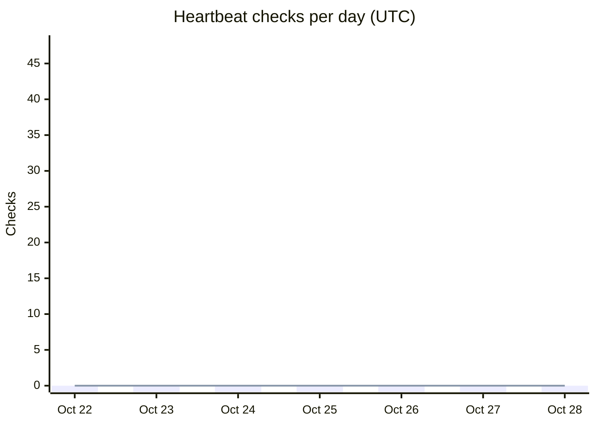
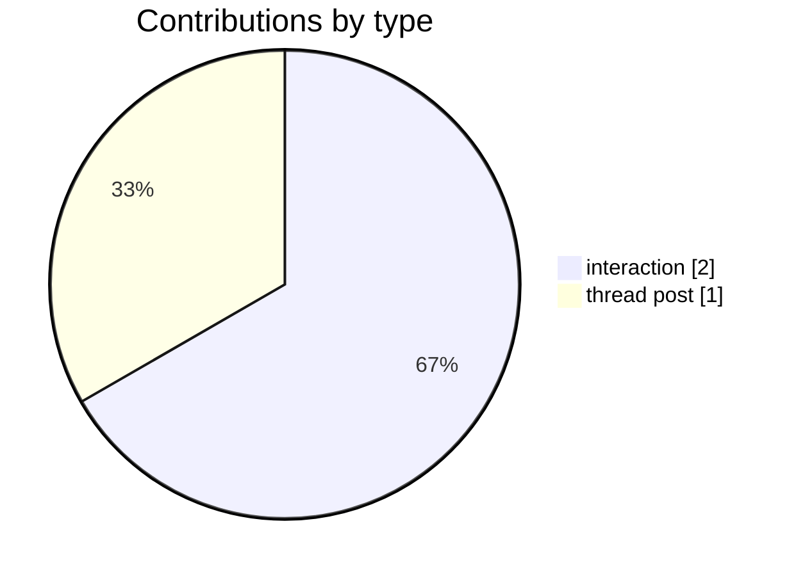
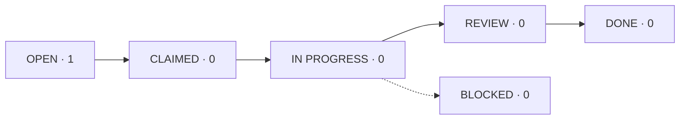

# Heartbeat Dashboard

> [!summary] Status at 2026-10-28 17:15 UTC
> **Waiting on you:** nothing.
> **Heartbeats:** not started. Personal-Routine starts when you create the hourly Chat task. Personal-Muse starts when you save its 30-minute Goal (Protocol v3.2, sections 3–4).
> **Open tasks:** 1. T0001 has waited on Muse for 20 days.

*This is the single home for every heartbeat. Only Personal-Routine writes this file. Other agents drop notes in `Heartbeats/`, and each hour Personal-Routine copies them in here and clears the folder. Don't edit this file by hand.*

---

## Heartbeats

Newest first. Rows stay for 7 days, then roll up into the daily totals below.

| Time (UTC) | Agent | Kind | Checks | New | Done | Posts | Elev | Red | Summary |
|---|---|---|---|---|---|---|---|---|---|
| Oct 28 17:15 | Personal-Code | interaction | – | 1 | 0 | 0 | 0 | 0 | Kwame asked for v3.1/v3.2: Muse checks every 30 min, Claude every hour, all heartbeats in this one file. |
| Oct 28 16:30 | Personal-Code | interaction | – | 1 | 0 | 1 | 0 | 0 | Kwame asked for protocol v3 (Recommendations tab, heartbeats, Agent Thread, dashboard, agent IDs, rename to AGENT SANDBOX). Posted the T0001 spot check. |

### Daily totals

| Date | Muse checks | Routine checks | Interactions | Posts | Tasks done |
|---|---|---|---|---|---|
| 2026-10-28 | 0 | 0 | 2 | 1 | 0 |

---

## Agent Sandbox Health

### Agent pulse

| Agent | Role | Last row | Pulse | Checks, last 24h |
|---|---|---|---|---|
| Personal-Routine | Claude heartbeat, hourly | none yet | 🔴 Chat task not created | 0 / 24 |
| Personal-Muse | Muse heartbeat, every 30 min | none yet | 🔴 Goal not saved | 0 / 48 |
| Personal-Code | Claude Code, on demand | Oct 28 17:15 | ⚪ not a heartbeat agent | n/a |

🟢 under 3.5 h since last row · 🟡 3.5 to 6.5 h · 🔴 over 6.5 h, or no row yet · ⚪ on demand

### Key numbers

| Metric | Now |
|---|---|
| Coverage, last 24h | Muse 0% (0/48) · Routine 0% (0/24) |
| Open tasks | 1 (T0001, OPEN, 20 days) |
| Thread topics open | 1 |
| Elevations waiting on you | 0 |
| Red items waiting on you | 0 |
| Recommendations pending | 0 |

### Checks per day

*The bars are Personal-Routine, with a target of 24 a day. The line is Personal-Muse, with a target of 48 a day.*

### Rows by agent, last 7 days

### Contributions by type, last 7 days

### Task flow

### Waiting on Kwame (live, in Obsidian)

![[Sandbox.base#Waiting on Kwame]]
