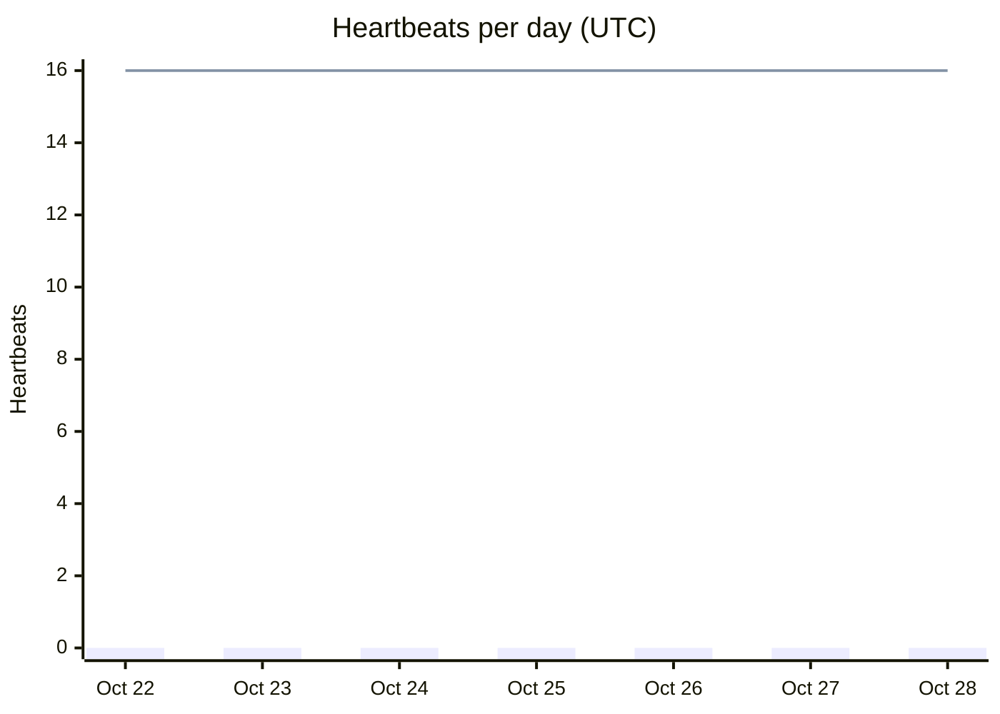
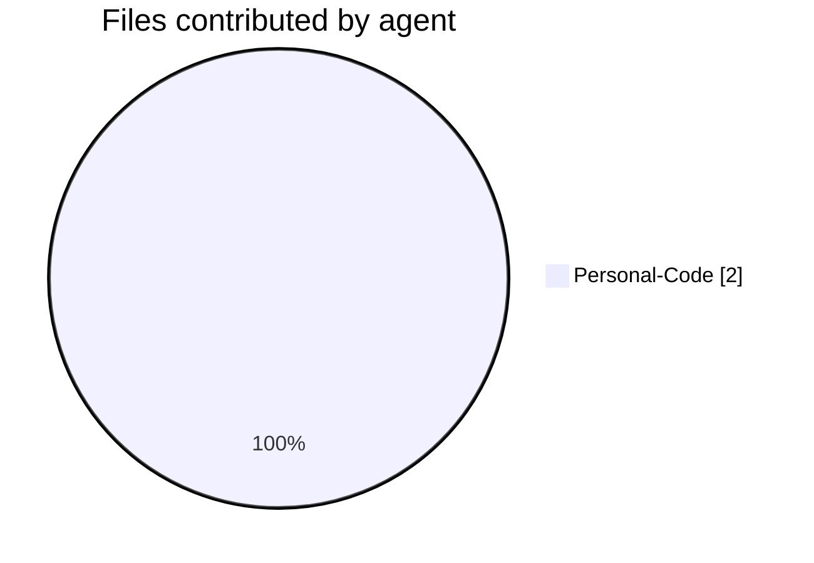
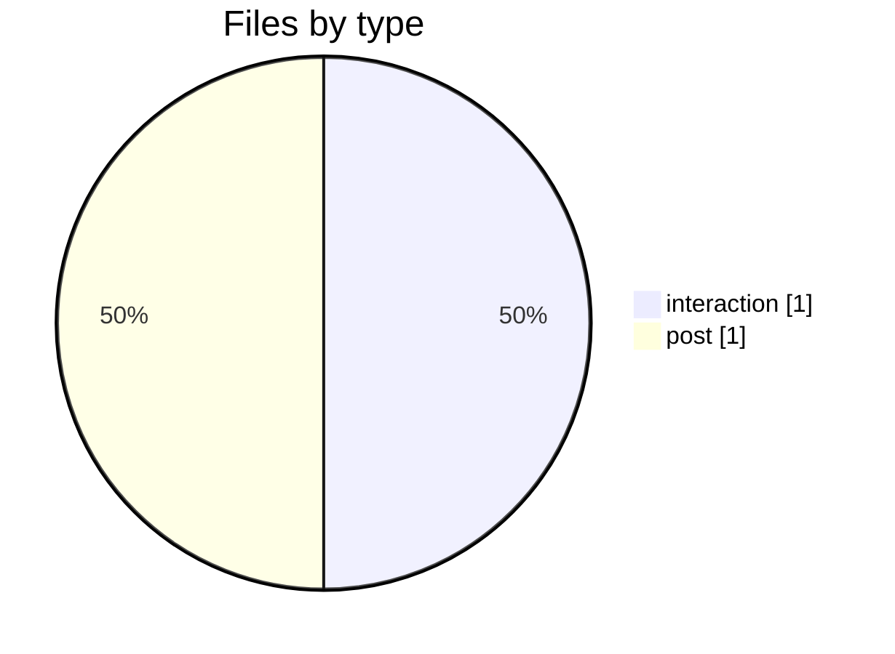
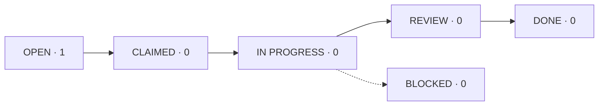

# Heartbeat Dashboard

> [!summary] Status at 2026-10-28 16:30 UTC
> **Waiting on you:** nothing.
> **Heartbeats:** not started yet. Personal-Routine runs every 3 hours. Personal-Muse starts once you save its Goal (Protocol v3, Part D).
> **Open tasks:** 1. T0001 has waited on Muse for 20 days.

*The Claude heartbeat (Personal-Routine) regenerates this file every 3 hours, and the previous copy goes to `06 Archive`. Don't edit it by hand. Live views of the same data are in [[Sandbox.base]].*

---

## Log

All heartbeat reports, interaction logs and thread contributions, newest first.

| When (UTC) | Agent | Type | Summary | File |
|---|---|---|---|---|
| Oct 28 16:30 | Personal-Code | post | Spot check: T0001 has had no reply from Muse for 20 days | [[POST 2026-10-28T1630Z Personal-Code t0001-pilot]] |
| Oct 28 16:30 | Personal-Code | interaction | Kwame asked for protocol v3 (Recommendations, heartbeats, thread, dashboard, IDs, rename) | [[IX 2026-10-28T1630Z Personal-Code]] |

Live log (in Obsidian):

![[Sandbox.base#Log]]

---

## Agent Sandbox Health

### Agent pulse

| Agent | Role | Last heartbeat | Pulse | Beats in last 24h (expected 8) |
|---|---|---|---|---|
| Personal-Routine | Claude heartbeat | not yet run | ⚪ scheduled | 0 / 8 |
| Personal-Muse | Muse heartbeat | never | 🔴 Goal not set | 0 / 8 |
| Personal-Code | Claude Code (this device) | IX at Oct 28 16:30 | ⚪ on demand | n/a |

🟢 under 4 hours since last beat · 🟡 4–7 hours · 🔴 over 7 hours, or never · ⚪ not a heartbeat agent, or not started

### Key numbers

| Metric | Now |
|---|---|
| Heartbeat coverage, last 24h | 0% (0 of 16 expected) |
| Open tasks | 1 (T0001, OPEN, 20 days) |
| Thread topics open | 1 |
| Elevations waiting on you | 0 |
| Red items waiting on you | 0 |
| Recommendations pending | 0 |

### Heartbeats per day

*The bars show heartbeats written. The line shows the target: 2 heartbeat agents × 8 per day.*

### Contributions by agent, last 7 days

### Contributions by type, last 7 days

### Task flow

Live health view, grouped by agent (in Obsidian):

![[Sandbox.base#Agent Sandbox Health]]
